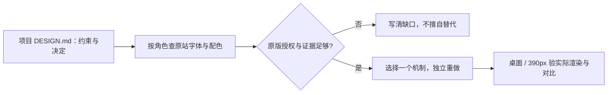

# Anduril × Saronic：字体、配色与工业编辑式版型

**先看他们实际选什么，再谈迁移。** 两站并非“一族打全站、无配对”，更不是“都用 Inter”。Anduril 是 **Helvetica Now Display + Elios**；Saronic 是 **Suisse Int'l + Suisse Int'l Mono**。这里保存事实与可独立重做的机制，不提供整站复刻包，不替任何消费项目选字体。

上游：[Anduril](https://www.anduril.com/) · [Saronic](https://www.saronic.com/)。研究日 **2026-11-03**。消费前先完整读项目 canonical `DESIGN.md`；本文只能提供证据，不能覆盖其约束，也不能把其中候选提案变成已批准决定。一般模式见 [B2B brochure](./b2b-brochure-sites.md)。



## 流程与证据等级

1. **先约束**：确认目标、已批准项、尚待决定项；字体、色板不能从模板倒推为项目合同。
2. **先事实**：按下面的 family / PS（PostScript name，字体内部标识）/ role 找证据。CSS 声明 ≠ 已下载 ≠ 实际出字。
3. **选一个配方**：选择 hero、规格、菜单或缝线机制，不把两站所有效果叠在一页。
4. **独立重做并验收**：合法字体、自己的内容和影像；桌面及 390px 检查行折、溢出、焦点、reduced-motion、图片上文字的实际合成对比。原版不可用时先记缺口，不自行宣布替代方案。

| 标记 | 证明了什么 | 没证明什么 |
|---|---|---|
| **[R] 原始抓取** | R1/R2 CSS/HTML + R3 双视口 computed/区块 DOM，可核角色、结构、断点 | 不自动证明实际渲染字体；容器继承值可能没有任何文字用到 |
| **[P] 平台字体实测** | 本次私有 Chromium 的 `CSS.getPlatformFontsForNode`、glyphCount、`document.fonts`、字体网络响应 | 只对 Ghost/Vessels 选中节点成立，不代表 11 页逐字审核 |
| **[I] 可迁移推断** | 从事实提炼的独立实现配方、消费边界 | 不是原站源码、品牌规范或消费项目已批准决定 |
| **[G] 缺口** | 明确未测、匿名信息、授权或抓取限制 | 不用猜测填满 |

### 本包保留的证据

- [measurements.json](./anduril-saronic-evidence/measurements.json)：**11 页 × 2 视口**的必要 computed 投影、R1/R2 `@font-face` 数值映射、来源相对路径与 SHA-256、对比计算。每种查询保留至多五个不同处理，非全量 DOM。
- [platform-fonts.json](./anduril-saronic-evidence/platform-fonts.json)：**Ghost / Vessels × 1440 / 390** 的实际出字、document.fonts、字体响应 URL/大小/hash、WOFF2 table 与 name 元数据；不含字体字节。
- 源研究位于 `cfe-app` 仓库 `docs/redesign-2026-11-03/`：R1 `benchmark-sites/anduril/{index.html,style.css}`；R2 `benchmark-sites-r2/saronic/{index.html,vessels.html,css-*.css}`；R3 `benchmark-sites-r3/{anduril,saronic}/` 与 `benchmark-sites-r3-anduril-saronic.md`。这些是历史来源定位，不是本文复用的运行依赖；原报告的领域建议没有迁入。
- 实测用**一只私有浏览器、两页依次检查**，未连接共享 9333；图片/视频请求禁用以节约资源，文字字体加载照常；检查后关闭。影像构图/动效事实来自 R3，而非本次重新视觉验收。

## 1. 覆盖的 11 页与抓取深度 [R]

R3 尺寸为 **1440×900 / 390×844**。路径缩写是证据文件名前缀，不是新增页面。

| # | 站点 / 页面 | 观察到的版型 | 深度 / 限制 |
|---|---|---|---|
| 1 | Anduril `/` (`home`) | 暗色视频 → 公告影像 → 不规则产品矩阵 → 灰/纸色编辑区 → 叠卡 | 双视口 + detail；首页 hero 文字未水合，不能当实际呈现 |
| 2 | Anduril `/ghost` | 巨型产品名 → 变体规格 → 3D → 编号特性 → 应用/认证 → 影像 | 双视口 + detail；本次补 [P] |
| 3 | Anduril `/barracuda` | 同产品模板，变体内容不同 | 双视口 + detail；未逐节点 [P] |
| 4 | Anduril `/roadrunner` | 产品模板 + 应用叙事带 | 双视口 + detail；未逐节点 [P] |
| 5 | Anduril `/mission` | 浅底 PageHero → 标题/双列/长段/Feature | 双视口 + detail；不是唯一浅底页面的全站断言 |
| 6 | Anduril `/news` | 编辑式页首 → 日期/标题/阅读入口的行列表 | 双视口 + detail；不把未抓到的 H1 猜成 Elios |
| 7 | Saronic `/` (`home`) | 满幅字标/视频 → 新闻 → 产品 → 用途 → 制造/软件 → 招聘 | 双视口 + detail；菜单另有历史 DOM |
| 8 | Saronic `/vessels` | display 页题 → 导语 → 三组产品/说明/规格 → 编号能力 | 双视口 + detail；本次补 [P] |
| 9 | Saronic `/echelon` | 深底软件影像 → 大标题/导语 → 编号手风琴 | 双视口 + detail；交互未逐状态重测 |
| 10 | Saronic `/mission` | 浅底同款 display 页题 → 大字号宣言长段 | 双视口 + detail |
| 11 | Saronic `/portalpha` | 制造/产能作为产品的长篇叙事 | 只有双视口页级抓取，**无逐块 detail** |

## 2. 字体：family、文件、weight 与实际角色

### 2.1 Anduril：Helvetica Now Display 主排版，Elios 少量辅助 [R/P]

CSS family 拼作 `HelveticaNowDisplay`；内部 typographic family 是 `Helvetica Now Display`。不要混称 Helvetica Now Text，也不要由产品系列存在 variable 版本推断网站用了 variable。

| CSS weight | 声明的独立文件名 | 本次实际渲染 / 验真范围 |
|---|---|---|
| 50 / 100 / 200 / 300 | Hairline / Thin / ExtLt / Light | R1 CSS 单值注册；本次未加载，文件内部未验 |
| **400** | Regular | [P] 规格值 → `HelveticaNowDisplay-Regular` |
| **500** | Medium | [P] 产品说明 → `HelveticaNowDisplay-Medium` |
| **700** | Bold | [P] 产品标题、规格 label → `HelveticaNowDisplay-Bold` |
| 800 / 900 / 950 | ExtraBold / Black / ExtBlk | R1 CSS 单值注册；本次未加载，文件内部未验 |
| Elios **400** | `Elios-Regular` | [P] `[AAV]` → `Elios-Regular`；节点 computed **500**，不等于存在 Medium 文件 |

- 本次网络收到 Regular/Medium/Bold/Elios，**四个 WOFF2 均无 `fvar` 表**，name table 与 CDP PS 一致：这些是 **static faces**。其余七档仅能确认“分文件单值注册”，不扩张为每个文件均已二进制检查。
- 主标题、普通说明、规格 label/value 属 Helvetica Now Display。**Elios 不是所有小字的统一字体**：是括号产品代号、部分 HUD/loader/书籍导航等辅助件。R1 CSS 还存在 Quote 等选择器，不能说“仅两处”。
- Elios 节点 CSS 请求 500，但注册只有 400；`font-synthesis` 允许 weight。**可确认出字源是 Regular，是否合成加粗未单独隔离，不能伪报 Elios Medium。**
- `nav`/slice 容器 computed 中的 Times New Roman 并不证明页面用衬线；有字的叶子被各自规则覆盖。[P] 测的是实际有字节点而不是空容器。

### 2.2 Saronic：Suisse Int'l + Suisse Int'l Mono [R/P]

next/font 的 CSS alias 为 `__Suisse_ddcbba` / `__SuisseMono_68313c`（hash 会随版本变），不能把这个 alias 当字体商品名。

| CSS 注册 | 站点角色 | 网络文件内部的 PS（具名子文件） |
|---|---|---|
| Suisse **400** normal / italic | display 页题、正文、桌面规格值 | `SuisseIntl-Regular` / `SuisseIntl-Italic` |
| Suisse **450** normal / italic | `type--weight-book`：导语、产品小标题、长篇使命段 | `SuisseIntl-Book` / `SuisseIntl-BookItalic` |
| Suisse **500** normal / italic | medium 强调角色 | `SuisseIntl-Medium` / `SuisseIntl-MediumItalic` |
| SuisseMono normal（默认 **400**） | 标签、按钮、导航工具字、首页 mono H1、移动规格值 | `SuisseIntlMono`（内部 family `Suisse Int'l Mono`） |

**450 是网站对 Book 的 CSS 映射，不是已验出的 variable 轴，也不能套到其他字体。** 每个 weight/style 有两个独立资源：一个主文件 + 一个很小的具名文件；两者不是两个字重。本次所收 14 个 WOFF2 均无 `fvar`，与单值 `@font-face` 共同支持 **static 部署**。

**重要证据限制：**

- 主文件的内部 name table 已匿名化（family 空、PS `Font`）；CDP 对 `Vessels`、导语及若干标签返回 `isCustomFont:true`、非零 glyphCount，但 PS 也是 **`Font`**。不把这些 glyph 偷改标成 `SuisseIntl-*`。
- 同节点 CSS 使用 Suisse/SuisseMono，`document.fonts` 为 loaded，网络与 CSS 映射到上述资源；桌面 `1,000+ nm` 的 CDP 同时返回 **`SuisseIntl-Regular` 3 glyph + 匿名 Font 6 glyph**；390 版本返回 **`SuisseIntlMono` 3 glyph + 匿名 Font 6 glyph**。这证明两角色的具名 face 确有实际参与，也解释为何不能仅凭 CSS 完成逐 glyph 归属。
- MENU computed 450，但 Mono 只注册默认 400；同样不能称存在“Mono Book 450”。Suisse fallback alias 指向 local Arial，不代表实际用了 Arial；本次平台节点没有把 Arial 报为渲染字体。

### 2.3 桌面 / 390 角色量尺

格式：**size / CSS weight / line-height / tracking，单位 px**。`normal` 保留原值，不等于显式 `0px`。小数取两位展示，JSON 留原精度。[P] 仅指上述选中节点；其余是 [R] computed，并非全站统一 token。`HND` = Helvetica Now Display；`SI` = Suisse Int'l；`SIM` = Suisse Int'l Mono。

| 角色 / 样本 | family | 1440 | 390 | 证据 |
|---|---|---|---|---|
| 产品名 H1（Ghost；另两产品同尺寸） | HND | **160 / 700 / 176 / −4** | **44.8 / 700 / 49.28 / −0.56** | [R/P] |
| 产品 hero 说明（不是普通正文） | HND | 12 / 500 / 12.6 / +0.48 | 13.006 / 500 / 13.656 / +0.518 | [P]；uppercase |
| `[AAV]` 代号 | Elios Regular | 12 / **500请求** / 12.6 / +0.48 | 13.006 / **500请求** / 13.656 / +0.518 | [P]；源 face 400 |
| 规格 label | HND | 12 / 700 / 12.6 / +0.48 | 13.006 / 700 / 13.656 / +0.518 | [P]；uppercase |
| 规格 value | HND | 15.008 / 400 / 18.010 / −0.144 | 16.002 / 400 / 19.202 / −0.154 | [P]；不能概括“移动等比缩” |
| Mission 大标题 | HND | 56 / 400 / 61.6 / −1.12 | 34.006 / 400 / 39.107 / −0.686 | [R] |
| Mission 导语段 | HND | 32 / 400 / 36.8 / −0.32 | 27.006 / 400 / 31.057 / −0.266 | [R] |
| 移动 nav link（隐藏桌面副本不算桌面 nav） | HND | 桌面该副本隐藏；主导航链接约 15 / 400 [R3报告] | 23.002 / 400 / 26.452 / −0.224 | [R]；桌面主链接完整 lh/tracking 未提取 |
| Vessels / Mission display | SI | **225.961 / 400 / 225.961 / −9.038** | **64 / 400 / 64 / −2.56** | [R/P] Vessels 匿名 PS 见上 |
| 产品名 / 页面导语 | SI Book | 34.980 / 450 / 41.976 / −0.700 | 导语 24 / 450 / 28.8 / −0.48 | [R/P] 导语；移动产品名隐藏不硬填 |
| 产品描述 body-large | SI Regular | 18.118 / 400 / 25.365 / −0.181 | **14 / 400 / 19.6 / −0.14** | [R]；不是所有正文均18px |
| 规格 label / 普通按钮 | SIM | 12 / 400 / 18 / normal | 12 / 400 / 18 / normal | [R/P] 规格 |
| 规格 value（两套 DOM 按断点显示） | **SI → SIM** | 28.235 / 400 / 35.294 / −0.565 | 12 / 400 / 18 / normal | [P]；不只是缩字号，换 family/布局 |
| 首页 H1 宣言 kicker | SIM | 21.490 / 400 / 32.235 / normal | 16 / 400 / 24 / normal | [R]；H1 不总是 display |
| 首页解释副题 | SI Book | 34.980 / 450 / 41.976 / −0.700 | 24 / 450 / 28.8 / −0.48 | [R] |
| Port Alpha H1 / Echelon h2 | SI Book | 78.431 / 450 / 86.275 / −3.137 | 40 / 450 / 44 / −1.6 | [R] |
| Port Alpha 正文 | SI Regular | 20 / 400 / 28 / −0.2 | 16 / 400 / 22.4 / −0.16 | [R] |
| MENU 工具字 | SIM | 12 / **450请求** / 18 / normal | 同桌面 | [R]；Mono 注册仅400 |

### 2.4 授权边界，不假装有等价替代

- **Helvetica Now Display** 是商业字体；复用需要合法的 **webfont / 域名、流量、用途**许可及对应文件来源。原站可下载 ≠ 授权再分发；网站的字体请求不是购买凭证。
- **Suisse Int'l / Suisse Int'l Mono** 属 Swiss Typefaces 商业系列，需核当前 web embedding/域名/流量等授权范围，不能从原站 hashed URL 搬字体。
- **Elios**：已确认实际名字与文件，**本次未核实官方供应方、许可条款与可购状态**。不能叫它免费字体，也不能据文件可访问就入库。
- 本包**不附任何字体二进制/许可授权书、不列主观免费替代清单**。原版拿不到或预算不符，记录“原版不可用 + 所缺授权/来源”；替代是后续单独决定，不能声称等宽/同类/免费就等价，不能自动回落到 Inter。
- 网页只证明 Latin 角色，没有证明这些文件覆盖中文；CJK 排版是新的项目边界。

## 3. 配色：原值、用途、面积与对比

**原站事实不等于本 pack 的铺底推荐。** 两站都有暗底与浅底主题，不是一个背景色跑到底。下表“面积”是所见组件的相对用途，不是已做像素分割的百分比；媒体、渐变与透明层使全站覆盖率不可由 CSS 频次推算。

### 3.1 Anduril 原始色 [R]

| HEX | 观察到的用途 | 面积 / 迁移注意 |
|---|---|---|
| `#000000` / `#010101` | body 黑底 / product header、深区、深墨字 | 大面积暗场；不是长期工具工作面的默认。保留原值不美化为“从不用纯黑” |
| `#F1F0EA` | 纸色卡、新闻区、浅页主题 | 大面积浅场；与暗场硬切。不是所有灰区都这个值 |
| **`#8E9291`** | 首页 ArsenalSlice 实测背景；部分中性层 | 可占整个区块。R3 把 Arsenal 与纸色等同的概括不准 |
| `#565654` | 浅底规格 value 等次级文字 | 小面积文字，保留深浅层级 |
| `#FFFFFF` | 深底反白文字 | 字形面积；图片上的白字仍需实测 |
| **`#DFF140`** | Ghost 区块 SVG `fill`；R1 CSS 也用于 loader、3D unsupported/active、链接/选中态 | 存在精确颜色证据；不是已测内联 background token。无全站面积百分比，不冒称唯一颜色 |

### 3.2 Saronic 原始色 [R]

| token / HEX | 观察到的用途 | 面积 / 迁移注意 |
|---|---|---|
| midnight300 **`#162029`** | 主深底、规格格底、亮按钮上的字 | 主表面，大面积 |
| midnight400 **`#0F161C`** | 更深主题（Echelon） | 整页/大区块 |
| 首页 body **`#1B2733`** | 页面局部主题注入 | 大面积；root `--body-bg:#fff` 不能当实际 body |
| sunlight100 **`#F2F6FA`** | 主浅字、Mission 浅底 | 整页浅主题或暗页文字 |
| midnight200 **`#44505C`** | 次按钮/中间灰阶 token | 部件级；不是所有缝线的实值 |
| **`#424B53`** | Vessels 外 grid computed 背景，`gap:1px` 露出 | 实际缝线；不要抹平成 midnight200 |
| midnight100 `#79848F` / midnight000 `#848B92` | 声明的灰阶 | [G] 本次未逐角色核实际覆盖 |
| sunlight200 `#D8E4EB` / sunlight300 `#AFC2CC` | 声明的浅色阶 | [G] 存在不等于普遍使用 |
| twilight100 `#89A2B0` / twilight300 `#1D4D68` | 声明的蓝灰辅色 | [G] 用途未逐节点确认，不凭命名派语义 |
| sonar **`#ACFF24`** | 主按钮、规格点标、announcement、菜单行动卡 | 常态小面积；公告条/整张菜单卡会集中放大，不能说“全站90%中性色”已验 |
| beacon **`#FB6B3C`** | 声明的第二强调色 | [G] 本次未证明具体主要组件；“只用一个强调色”不够准确 |
| sunlight100 at 70% 等 | 规格 label、辅助字/叠层 | 取决于合成底色；不是新 HEX，也不是自动过 AA |

### 3.3 静态色对计算（不是全站 AA 审计）

算法：sRGB 线性相对亮度 `(Lmax+.05)/(Lmin+.05)`；70% 项先按指定实底合成并舍入 8-bit。计算输入/输出随 JSON 保存。普通文字 ≥4.5:1、大字 ≥3:1；必要控件边界/focus ≥3:1。装饰线本身不必3:1，但不能承担唯一交互识别。

| 色对 | 比值 | 注意 |
|---|---:|---|
| acid `#DFF140` / `#010101` | **16.69:1** | 深底可读；反向同值 |
| acid / paper `#F1F0EA` | **1.10:1** | 浅底小字、必要边界不成立 |
| `#565654` / paper | **6.44:1** | 静态规格值色对通过普通文字阈值 |
| `#8E9291` / paper | **2.76:1** | 不能因此把此背景灰直接用作辅助字 |
| sonar / midnight300 | **13.42:1** | 亮钮+深字与暗底亮字可成立 |
| sonar / sunlight100 | **1.13:1** | 浅主题不能照搬绿字 |
| beacon / midnight300 | **5.71:1** | 指定深底普通字色对成立 |
| beacon / sunlight100 | **2.66:1** | 指定浅底连大字3:1也不足 |
| sunlight100 / midnight300 | **15.19:1** | 深浅轴 |
| sunlight100 70% / midnight300 | **8.06:1** | 只对这个指定底色成立 |
| midnight200 / midnight300 | **2.00:1** | 次按钮的唯一识别边界/focus需另验 |
| 实际 seam `#424B53` / midnight300 | **1.86:1** | 仅装饰性分隔可用，不能当唯一控件边界 |

**[I] 迁移面积纪律**：先确定页面主底/文字轴，再只给实际需要的 CTA、证据条或点标 accent；不把两站绿直接变成通用 success。面积预算由项目决定；这里没有可靠的 90/9/1 或精确像素占比。与本 pack 的日用工作面默认冲突时，遵守 [Color / surface](../design-color-surface-preferences.md)，标杆色值保留为研究事实。

## 4. 可独立重做的版型配方

以下先列 [R]，再列 [I]；不迁移业务领域、品牌字标、口号或专有媒体。

### Nav / menu：目录暴露与预览两种强度

- **[R] Anduril**：72px desktop nav，logo + 平铺领域链接 + Search/Company；部分链接有正常/隐藏文本双份 DOM 以保宽/换字。移动端是暗色全屏文字列表，页尾 contact/social；footer 四列在窄屏变 accordion。
- **[R] Saronic**：64px sticky header，右侧 Careers/MENU mono 12px；滚动隐藏用状态属性+translate。桌面 overlay 是右侧约55%面板、2×3 预览卡，卡含标题/一句说明，末卡亮绿行动位。不是普通mega link表。
- **[I] 配方**：导航项本身足以解释去向就用纯列表；陌生概念确需一句说明才用预览卡。不为“像标杆”添加 Search、双份文字 hover 或昂贵大菜单。主转化入口是否常驻由项目目标定，不能学完把联系藏没了。
- **[G]** 历史 DOM/截图证明形态，未重测完整 Escape、Tab 循环、焦点恢复。独立实现必须补真 button、`aria-expanded`、背景隔离和关闭后的焦点归位；这不是原站已通过 a11y 的结论。

### Hero：分清大字、解释文字与影像

- **[R] Anduril home**：96svh 暗视频，下一块公告影像后接不规则产品 bento。历史抓取的标题是 `@[shortTitle]`/`@[title]`、隐藏节点；不能据此断言用户真实看到“没有标题”。
- **[R] Anduril product**：160px 名称巨标 + 左右分配的品类/代号与说明 + 下方主影像；规格在后续变体卡，不挤在 hero。
- **[R] Saronic home**：满幅字标是 SVG，不是“226px 字体”；内容块置右下，mono 宣言 H1 + Suisse Book 解释副题 + 双CTA。Vessels/Mission 的226px才是文字 display。
- **[I] 配方**：一个清楚的对象名/主张、一句解释、主影像、一主一辅动作；巨标负责身份、段落负责解释，不能拿品牌知名度当新项目的理解成本。没有合法视频就记素材缺口，不搬原片。

### Spec：两种可复用的信息密度

- **[R] Anduril 紧凑行**：纸色变体卡，label 12px/700 uppercase，上/下排列灰 value 15px/400，hairline 行分隔；样本四项。390 的 label/value 反而约13/16px，不是所有东西按比例缩。
- **[R] Saronic 展示格**：`dl` 三列，8px accent 点标，上方留较大空隙（样本约96px），mono label + 28.235px sans value，`gap:1px` 缝与说明/图格一致。限定词作为值的副行，不让 label 变成长句。
- **[R] 390 双态**：Saronic `dl` 转纵排，值由 sans 大字换成 mono 12px，原 DOM 两份值断点切 `display`。
- **[I] 配方**：紧凑事实选 label/value 行；少数关键指标选大值格。用 `dl/dt/dd` 表达关系、共享同一个数据源；若确需双份展示，保证隐藏副本不重复进入可访问树，不手工维护两套事实。数字及限定条件必须真实，不借标杆数值。

### Seam / grid：分隔符系统，不是“所有gap都1px”

- **[R] Anduril**：12列；1440视口受滚动条影响内容宽1425、页边32，内宽1361、列约96.906、横gap18px。首页产品矩阵本身也有18/20px间隔，不能笼统称全站1px黑缝。
- **[R] Saronic**：VesselShowcase 内宽1360，`679.5px 679.5px` 两列、gap1px、背景 `#424B53`，子格 midnight300。`--page-margin` 的 root 默认16不代表宽屏实际页边；此组件宽屏是40px边。
- **[I] 配方**：大层布局用正常 gutter，单元格内部分割才用“父底色 + 1px gap”；子格必须不透明。不要在父gap和子border上重复画两条线。标题、规格、编号特性可共用这个分隔语法。

### Motion：记录实际长短，不强行压成一个区间

- **[R] Anduril**：多数UI约.2–.3s；media opacity `1s cubic-bezier(.19,1,.22,1)`；本次标题 span 的 inline transform 还有 **1500ms**，所以“全站0.15–0.6秒”不成立。Lenis 存在是技术事实，不是必须复用的价值。
- **[R] Saronic**：PageTitle `clip-path/transform 1s cubic-bezier(.25,.25,0,1)`；首页 H1 有 **1.2s + .3s delay** 的 opacity/transform；显示状态用 data 属性。不是所有运动都仅opacity/transform，clip-path 是实测事实。
- **[I] 配方**：分别设UI、文字reveal、影像三档；只实现内容真的受益的一档。使用原生滚动，reduced-motion时取消位移/裁切/等待；SSR可读内容不依赖动画“救活”。不复制Lenis/3D查看器来凑质感。

### Responsive：换角色与结构，不只是缩放

- **[R] Anduril**：主要768px断点，另有1280/960/400及超宽档；产品H1 160→44.8，label 12→约13、value15→16；bento改单列/局部双列；footer变accordion。
- **[R] Saronic**：主960px（≤959 / ≥960），另640/1280；display226→64、kicker21.49→16，产品2列→1列；规格大sans值→小mono；按钮`SPECIFICATIONS`缩为`SPECS`，有全宽化。
- **[I] 配方**：宽屏的“展示”变窄屏的“查询”，允许删装饰、缩写非歧义文案、改信息排列；不照抄断点数字当跨项目标准。检查390之外还要检查目标项目的最小宽度与长翻译，本次并未验证它们。

## 5. 事实纠偏、缺口与复用边界

### 已纠正的过度概括

1. “14/14 一族、无配对” → **有主family + 辅助family的角色分工**；也不能反向规定所有项目只能两族。
2. “Anduril Elios 只做mono标签 / Newsroom一定是Elios” → 只确认具体选择器与PS；Newsroom样本label computed是 HelveticaNowDisplay。Elios是否严格等宽未验，不为HUD气质自动称mono。
3. “Saronic所有文字都Suisse、所有H1都是大display” → 首页H1是Mono kicker；规格窄屏也换Mono。
4. “Saronic token midnight200就是实际seam / Anduril Arsenal就是paper” → 实值分别为`#424B53` / `#8E9291`。
5. “暗底≥90%、单强调色是已测全站结论” → 未量像素面积，且有第二强调色声明、大面积浅页与亮公告条。

### 明确未完成 [G]

- 11页均有历史computed，但只有Ghost/Vessels选中节点补平台字体证据；不声称每页都用CDP逐字验过。
- Saronic主文件PS匿名化；具名子文件和混合glyph实测可支持family角色，但不足以给每个匿名glyph下确定PS。390的通用label查询与specLabel命中同一节点，前者标记被覆盖导致空返回；以非空specLabel记录为准，JSON保留原因，不把空结果误当缺字体。
- Anduril首页hero未水合、3D headless显示unsupported；Saronic Port Alpha未逐块拆；其他未列页面不在覆盖范围。
- 未做全站色面积分割、逐张视频/摄影对比、全状态菜单/a11y、完整动效时间线；商业字体授权与Elios来源尚未取得。
- **不迁移**字体二进制、照片、视频、logo、slogan、成套HTML/JS/CSS、46MB截图。只存测量JSON和下面这个独立写的小配方。

### 独立重写的最小 token / seam 配方 [I]

这是**研究试排片段，不是默认品牌主题**。`--brand-*-licensed` 须由消费项目在授权与决定成立后明确绑定；未绑定则保持缺口，本文不暗塞免费字体或Inter回退。

```css
.research-surface {
  /* 示例原值选Saronic一组；不自动应用于消费项目 */
  --study-surface: #162029;
  --study-ink: #f2f6fa;
  --study-seam: #424b53;
  --study-accent: #acff24;
  --type-main: var(--brand-main-licensed);
  --type-label: var(--brand-label-licensed);
  background: var(--study-surface);
  color: var(--study-ink);
}
.study-specs {
  display: grid;
  grid-template-columns: repeat(3, minmax(0, 1fr));
  gap: 1px;
  background: var(--study-seam);
}
.study-specs > div { padding: 40px; background: var(--study-surface); }
.study-specs dt { font: 400 12px/1.5 var(--type-label); text-transform: uppercase; }
.study-specs dd { margin: 0; font: 400 28.235px/1.25 var(--type-main); letter-spacing: -.02em; }
@media (max-width: 959px) {
  .study-specs { grid-template-columns: 1fr; }
  .study-specs > div { padding: 16px; }
  .study-specs dd { font: 400 12px/1.5 var(--type-label); letter-spacing: normal; }
}
```

**终点**：角色、文件类型、映射与局限已可离开源项目独立查询；真正落产品前仍需消费项目决定、合法字体来源、真实素材与浏览器验收。研究资产的“可用”不等于某个网站已经改好。
