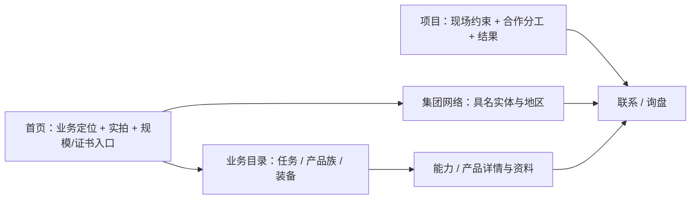

# Franklin Offshore：把规模感变成可核对的交付证据

上游：[franklinoffshore.com](https://franklinoffshore.com/) · 实测 **2026-11-03**。先完整读消费项目的 canonical `DESIGN.md`；本文是证据与机制库，不是默认字族、色板或可复制的客户资质库。相邻参照：[Anduril / Saronic](./anduril-saronic-dna.md)、[B2B brochure 模式](./b2b-brochure-sites.md)。

**值得学的是“全球、全流程、能交付”如何被买家逐项核查，不是默认照搬蓝白皮肤。** 字体实际为 **Articulat CF**，不是凭海工行业印象猜的 Plex/Inter；主站标题与正文的文件/角色由真实 glyph 和网络资源验真。

这是可迁移的买家路径，不宣称图中每条都是原站直接链接。全球header/footer承担一部分通路。

## 1. 流程与覆盖

1. 查合同：项目需求与品牌边界优先，母集团/对标身份不是整站视觉批准。
2. 按下表定位原站角色；对照片、证书、能力数字标主体和授权，不把集团业绩当子公司所有。
3. 选一个已证明的机制落地：任务目录、可读参数、项目叙事或地区联系人；不叠全套效果。
4. 桌面/窄屏验字体、内容可读、联系可达与分享名片；表单前端存在不等于询盘闭环。

七个主样本均做 **1440×1000 / 目标390×844** 取证，另取 Products 双端发现样本。**六页双端viewport一致；Services移动字体采样时433、稍后layout为390，属切换中间态，不计稳定390字体验收。** 下方角色表不用该份Services移动值：

| 样本 | URL | 用途 |
|---|---|---|
| Home | `/` | 定位、影像、规模计数、网络与证书 |
| About | `/about/` | 具名实体、全球地区、证书入口 |
| Services | `/services/` | Inspection/Fabrication/Mooring/Rental/Testing/Installation/Training/EES任务目录 |
| Fabrication | `/product-service-post/fabrication/` | 从工程、采购到制造、测试、交付的流程 |
| Steel Wire Rope | `/product-service-post/steel-wire-rope/` | 应用环境、类型、库存与资料 |
| Project | `/news-events-posts/conquering-challenges-delivering-offshore-excellence/` | 项目新闻中的现场约束与合作边界 |
| Contact | `/contact-us/` | 多实体联系、电话邮件、轻表单 |
| Products（补充） | `/products/` | 产品族与锚点目录，不是新增主样本 |

**便携证据**：[measurements.json](./franklin-offshore-evidence/measurements.json) 保存八页目标双宽的最小样式/平台字体投影、Services中间态排除标记、16个来源hash、Typekit face/WOFF2表信息、颜色节点与四页metadata；[share-surfaces.json](./franklin-offshore-evidence/share-surfaces.json) 保存三站首页head/OG/favicon元信息，不含图像字节。源报告在 `cfe-app` 仓 `docs/redesign-2026-11-03/benchmark-franklin-offshore.md` 及相邻证据目录；便携JSON不依赖该仓才能查询字体/色板。

## 2. 实际字体：Articulat CF，不按数字猜文件

**事实**：叶子节点 CSS 为 `articulat-cf, sans-serif`；`CSS.getPlatformFontsForNode` 返回 `isCustomFont:true` 与非零glyph。桌面nav外层看似系统栈，文字span实际是Articulat；父节点会汇总后代字体，不能误把父computed当出字来源。

| 角色 | CSS weight → 实际PS | 1440的size / line-height | 390的size / line-height |
|---|---|---:|---:|
| 首页 `TOTAL+` H1 | **600 → ArticulatCF-Medium** | 122.4 / 122.4 | 39 / 39 |
| 首页 `SOLUTIONS` H1 | 600 → Medium | 79.2 / 79.2 | 33.15 / 33.15 |
| 普通页Hero H1（Contact） | 600 → Medium | 86.4 / 86.4 | 33.15 / 33.15 |
| 首页section H2 | 600 → Medium | 50.4 / 60.48 | 29.25 / 35.1 |
| Fabrication正文 | **400 → ArticulatCF-Normal** | 14.4 / 21.6 | 13.65 / 20.475 |
| 首页部分正文 | 600 → Medium | 14.4 / 21.6 | 13.65 / 20.475 |
| Header nav / 移动菜单 | 桌面600→Medium；移动400→Normal | 14.4 / 21.6 | 12.87 / 19.305 |
| Label / 普通按钮 | 400 → Normal | 14.4 / 21.6 | 13.65 / 20.475 |

- 以上 `letter-spacing` 均为 **normal**；不是仿照Saronic统一加负字距。
- 正文有400和600两种，不能说“一套family=全站相同weight”；Medium的CSS映射是**600**，不能擅改写成500。
- 实页加载 Adobe Typekit `xws0qwn.css`，注册400/500/600/700 normal/italic与heavy900，`font-display:auto`。本次检查的400/500/600 WOFF2分别21,556 / 17,464 / 17,588B，均无`fvar`：**实际检查文件是static faces**。未验未加载的所有文件。
- `Instrument Serif`由聊天widget注册但样本时unloaded，不算主站衬线配对；版权心形的系统fallback不算另一套正文系统。
- 字体是商业/Adobe分发来源；本包不含字体文件，不把原站kit当消费项目许可，也不自荐免费“等价款”。

**迁移边界**：角色组织可学，原站13px正文不自动成为消费项目下限；最终family、加载方式及授权在项目合同中确定。

## 3. 实际色板与状态

| HEX | 原站角色 | 证据边界 |
|---|---|---|
| `#FFFFFF` | 页面/header白底、照片/深底反白字 | 大面积表面；不是通用工作面建议 |
| **`#00162A`** | 主文案/标题、深底区、表单文字与边界 | 很深的蓝，不能概括成中性纯黑 |
| **`#004A98`** | primary实底CTA与表单提交钮 | Header Contact hover仍同色，scale1.1 |
| `#00284D` | 第二层深蓝section底 | 层次用色，不是又一个CTA色 |
| `#DEEBF8` | kit accent浅蓝声明 | 已确认token存在，未逐角色证明实际面积 |
| `#D7D8D8` | Contact非当前菜单边界样本 | 不是全站统一divider的充分证据 |
| `#333333` | body继承默认 | 核心文字leaf多覆盖成深蓝，不能误报主文案色 |

Header Contact hover实测`transform:scale(1.1)`、0.3s；submit hover规则是深蓝`#00162A`，未提交。nav父级hover规则与anchor伪状态采样要分开，未成功触发的样本不报“交互验过”。颜色不是从工业照片取样。

**独立重做的关系**：统一CTA色、分清主文案/深区/浅面、实拍承担场景信息。消费项目明确避蓝时只借关系，不复制母集团蓝色覆盖客户约束。

## 4. 四种值得复用的机制

### 业务目录把“全流程”翻译成采购任务

**事实**：Services按Inspection/Fabrication/Mooring/Testing等任务分，Mooring再细分temporary/permanent与工程、安装、维护；产品页用rigging、wire rope等产品族。设备能力以绞车/张紧器/试验台等具名对象与数字呈现，而非只有“创新可靠”。

**配方**：`买家任务 → 能力范围 → 适用对象/边界 → 设备或已核事实 → 资料/联系`。能力数字必须自己的、已核实且标主体；不迁移来源的吨位、经验年数、合作伙伴数。

### 项目写现场约束与合作分工

**事实**：项目样本来自News，不另有已测Projects栏目；文章写FPSO系泊复接、海床与物流挑战、各合作方贡献。

**配方**：`任务 / 场景 → 现场约束 → 本公司与伙伴各做什么 → 可证结果 → 相关能力/联系`。这比“行业领先”更可检查；原站自述不是独立成效审计，案例与照片先核授权。

### 集团背书落实到实体和联系人

**事实**：About新加坡定位与全球地区入口，Contact并列Franklin Offshore International、CFE Engineers Asia、Energy Equipment Service及地址/邮箱/电话。网站上有实体名不自动证明所有法律关系。原站About/Contact的11/12地点口径也有不一致。

**配方**：一份核实的实体/地点数据同时驱动网络、联系方式与标注；证书列持有人、标准、有效期及核验入口。不能只放证书翻转卡，也不能把集团历史写成子公司历史。

### 联系与资料分轨，不虚报闭环

**事实**：桌面header、页尾CTA、电话邮件与Contact六字段表单可达；姓名/邮箱/Purpose必填，电话/Message选填，无当次附件输入。只聚焦了空First Name，未输入或提交。移动header隐藏Contact按钮，但菜单内保留。存在聊天widget，不代表已测其能力。

**配方**：全局可达的联系主轨 + 资料次轨；能力/产品上下文传到询盘。另验草稿、附件、未知结果、接收/审批/回复等真实状态；不要把按钮和表单存在当送达与回复已完成。

## 5. 不照搬的结构和动效

- Services样本约9700px长，目录完整不等于易读；小体量公司不必复制全矩阵。
- Elementor fadeIn实测1.25s，分批延迟400–1000ms；有parallax设置。多数Swiper自动播放关闭，但证书轮播autoplay5000ms，不能说全站无自动轮播。
- 主断点CSS为1024/767，采样仅1440/390，不声称所有中间宽度都验过。
- 初始后台tab有隐藏揭示内容，激活并真滚动后可见；不能把动画中间白屏当最终站点表现。没有移除DOM隐藏类作弊。
- 移动菜单打开过，完整Tab/Escape/focus隔离、reduced-motion、触屏滑动及所有地区弹层未审。业务关键事实应可直接读，不依赖特效救活。

## 6. 分享名片与机器可读表面同样要拆

| 表面 | Franklin事实 | 可复用取舍 |
|---|---|---|
| 首页title/摘要 | `Homepage - Franklin Offshore`；摘要说明rigging/mooring/offshore oil & gas/worldwide | 接线有、定位可读，但title仍泛；别把“有标签”当文案做好 |
| OG | 首页航拍WebP1024×767；产品详情还出现425×536竖图 | 真实工业摄影可建立场景，但预览构图/中心裁切/品牌辨认需独立设计 |
| favicon | 实100×100 PNG，同URL却声明32/192px | 检查实际文件，不只读sizes属性 |
| 业务详情索引 | 两个样本`noindex,follow`，无普通description/canonical，OG仍存在 | 预览可见和可索引不是同一件事；应获客的页需要明确索引策略 |
| schema | Yoast页面/站点/组织graph，四页未见Product/Service/ContactPoint | 先表达真实业务与实体，不为凑类型写假参数 |

三站首页比较在便携[share-surfaces.json](./franklin-offshore-evidence/share-surfaces.json)：Anduril/Saronic都是1200×630字标OG卡；Saronic的OG标题只是`Home`，同样可改进。没有重建Telegram缓存或测试真实排名/AI引用，不拿source HTML元信息等同平台成效。

复用验收走[品牌资产入口](../brand-identity/SKILL.md)：source HTML、真实资源、320px缩略图、16/32px图标、公开抓取、正式域名与schema一致。OG好看不保证SEO/GEO有效，llms文件有无也不证明引用成绩。

## 7. 边界与完成标准

- 只存测量/URL/hash/有限文案作为证据；不保存可复用字体、照片、视频、logo或成套HTML/CSS。
- 未提交表单、联系外人、发送聊天或调用收费服务；询盘后台、证书有效期/真实性、PDF内容及法律关系不在本次验证范围。
- 本包保存的出字/色板/metadata可独立查询；业务归纳与实施配方是解释，不冒充原站品牌规范。一次私有浏览器已关闭，未动共享工作tab。
- 下一次消费先回项目总合同：明确取哪一项、为什么、合法素材/字体来源及可观察验收；不因参考站已实现就自动部署。
