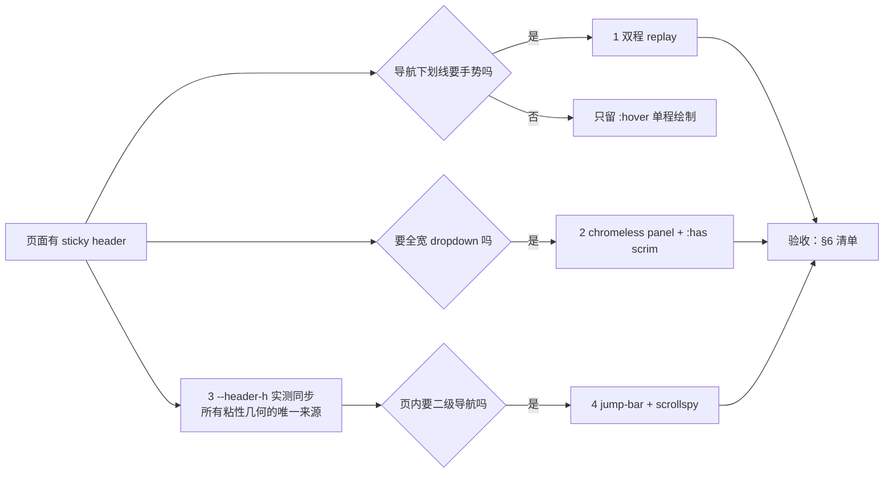

# Header nav + jump bar：下划线 replay、chromeless dropdown、实测 header 高、页内 scrollspy

四个机制来自同一个工业站顶部 chrome，但彼此独立：可以只取 replay，也可以只取 `--header-h` 同步。它们共享一个前提——**导航是粘的（sticky），页面内容从它下面滚过去**，所以「导航多高」是页面几何的一等输入，不能靠猜。

上游：Anduril 的 `linkbutton-underline-replay` 手势、chromeless 全宽 panel + 页面压暗；Fugro 的 sticky 章节锚点条与 "X overview" 芯片行。实现参考为 Astro 站的 `src/styles/global.css`、`src/scripts/site.ts`、`src/styles/tokens.css`；本文只保留机制，不含该站字体、色值、文案与照片。

**可运行的最小演示（同时是骨架）：** [`snippets/header-nav-and-jump-bar.html`](./snippets/header-nav-and-jump-bar.html) —— 原生 HTML/CSS/JS，无框架、无依赖，直接开浏览器即可对照本文每个数字。



---

## 1. 流程（按序，终点怎么判）

1. **先定 sticky 几何的唯一来源**：header 高度只在一个地方定义（`--header-h`），所有依赖它的东西——`scroll-padding-top`、jump-bar 的 `top`、scrim 的 `inset`、hero 的负 margin——都引用这个变量。**不要在任何地方写第二个 px 值。**
2. **在 tokens 里给一个首屏字面量，然后用 JS 覆盖它**。字面量只负责「JS 还没跑之前不闪」，不承担正确性。
3. **决定 dropdown 用哪条路径开合**：CSS `:hover` / `:focus-within` 开（无 JS 可用），JS 只维护 `aria-expanded`、Escape 与 suppress。**不要把开合本身搬进 JS**，否则键盘和 no-JS 都会退化。
4. **先量 hover 走廊，再调视觉**。panel 贴 header 底边时，header 的 padding-bottom 就是死区（§4.1）。走廊不通，其它都白做。
5. **replay 只在 `pointerleave` 上挂**，监听器放在 item 而不是 link 上（§3.2）。
6. **scrollspy 用 IntersectionObserver 的 band，不用 `scrollY > N`**；同时把「band 空」的两种合法情况补掉（§5.4）。
7. **终点判定**：§6 清单全绿。构建通过、截图"看着挺像"都不算——这四个机制的失效方式全是「看着对、用起来断」。

---

## 2. 何时用 / 何时不用

| 用 | 不用 |
|---|---|
| 工业 / 能源 / 工程 / 防务类企业站，5–7 个一级项 + 二级 panel | 只有 3–4 个链接、没有二级内容的轻站 → panel 与 replay 都是多余机械 |
| 导航常驻且内容从下方滚过（sticky 前提成立） | 导航随页面滚走的一次性 landing → `--header-h` 同步没有消费者 |
| 长页需要第二层页内定位（about / services / products 这类多段页） | 一屏就结束的页面 → jump-bar 只会多一条 chrome |
| 想让 hover 有「机械复位」的手感，而不是柔和淡入 | 玻璃 / 液态 / 连续形变体系 → 这里的语言是直线与硬边，混用会打架 |

**硬边界**：本文四个机制都是 **navigation 层**。不要把它们挪到内容层做装饰，也不要在已经上了玻璃胶囊导航的页面上再叠一套（见 [`scroll-shrink-glass-capsule-nav.md`](./scroll-shrink-glass-capsule-nav.md)——那是滚动驱动几何收缩，这里是 hover 驱动状态切换，二选一）。

---

## 3. 机制一：双程下划线 replay

### 3.1 它到底是什么

不是"下划线淡入淡出"，是**线自己重画一遍**：

```
静止：scaleX(0)，origin: right
hover：scaleX(1)，origin: left        ← 从左往右画出来（250ms）
离开：550ms 一次双程
        0%    scaleX(1)  origin right
        45%   scaleX(0)  origin right   ← 向右收回去
        55%   scaleX(0)  origin left    ← 在宽度为 0 时翻原点（看不见，所以不闪）
        90%   scaleX(1)  origin left    ← 再从左边画出来
        100%  scaleX(0)  origin right   ← 再向右收回去
```

关键在 **45%→55% 这 10% 的区间**：线宽已经是 0，此时翻 `transform-origin` 不产生任何可见位移。所有"翻原点会跳一下"的问题都来自在非零宽度时翻。

### 3.2 最小骨架

```css
.nav-link { position: relative; }
.nav-link::after {
  content: ''; position: absolute; left: 0; right: 0; bottom: -0.3rem;
  height: 1px; background: var(--accent);
  transform: scaleX(0); transform-origin: right;
  transition: transform 250ms var(--ease-out);
}
.nav-link:hover::after,
.nav-link:focus-visible::after,
.nav-item:focus-within > .nav-link::after,
.nav-item:hover > .nav-link::after {
  transform: scaleX(1); transform-origin: left;
}

.nav-link.is-replaying::after { animation: nav-underline-replay 550ms var(--ease-out); }

@keyframes nav-underline-replay {
  0%   { transform-origin: right; transform: scaleX(1); }
  45%  { transform-origin: right; transform: scaleX(0); }
  55%  { transform-origin: left;  transform: scaleX(0); }
  90%  { transform-origin: left;  transform: scaleX(1); }
  100% { transform-origin: right; transform: scaleX(0); }
}
```

```js
const reduceMotion = matchMedia('(prefers-reduced-motion: reduce)').matches;
if (!reduceMotion) {
  document.querySelectorAll('.desktop-nav .nav-item').forEach((item) => {
    const link = item.querySelector('a.nav-link');
    if (!link) return;
    item.addEventListener('pointerleave', () => {          // 监听 item，不是 link
      link.classList.remove('is-replaying');
      void link.offsetWidth;                               // 飞行中重入也能重放
      link.classList.add('is-replaying');
    });
    link.addEventListener('animationend', () => link.classList.remove('is-replaying'));
    link.addEventListener('pointerenter', () => link.classList.remove('is-replaying')); // 见 §4.2
  });
}
```

### 3.3 为什么监听器必须在 item 上

`pointerleave` 挂 link 上，指针从 link 往下移进 panel 时会立刻触发 replay；挂 item 上，只要 item 的盒子覆盖住「link → panel」的整条路径，移动过程中就不会离开 item，下划线保持绘制状态。**这个设计对盒子几何有硬依赖**——盒子不通，见 §4.1。

### 3.4 归位与 reduced-motion

- **动画终点是 `scaleX(0)`，正好等于静止态**，所以移除 class 永远不跳。任何让 100% 停在 `scaleX(1)` 的改法都会在 class 移除时闪一下。
- `prefers-reduced-motion: reduce` 下：**不挂监听器**（不是把时长改成 0.01ms），并把 `transition` / `animation` 一起关掉。功能（下划线仍随 hover 出现）保留，手势去掉。
- 页面上 `aria-current="page"` 的当前项**不画常驻线**，只加重字重与墨色。常驻线会和打开中的 panel 抢注意力，也会让 replay 失去起点。

### 3.5 线宽为什么是 1px

14px 字号下 2px 会读成 tab indicator；如果站点其它边界都是 1px hairline，下划线必须同族。这是"线的语义"问题，不是审美偏好。

---

## 4. 机制二：chromeless 全宽 dropdown + `:has()` 整页 scrim

### 4.1 先修走廊，再谈视觉（最容易踩的坑）

panel 用 `position: absolute; top: 100%` 贴 **header**（不是 item）的底边，才能做到通栏。但 header 有 `padding-block`，于是 **item 底边到 panel 顶边之间存在一条死带**：

```
实测（该站 1440px）：header 65.78px = 10.4 padding-top + 44 item + 10.4 padding-bottom + 1 border
                     item 底 54.39 → panel 顶 70.78  ⇒ 死带 16.39px
```

指针穿过这 16px 时：离开 item → `:hover` 掉 → panel 关闭 → 指针到达时 panel 已经不在了。**表现为"鼠标一往下移菜单就闪没"，而且只在真实指针下复现，截图永远看不出来。**

两种修法，推荐第一种：

```css
/* A. 把 item 的盒子向下延伸到 header 的底边（负 margin 抵消，行高不变） */
.site-header { --header-pad-y: 0.65rem; --header-rule: 1px; }
.nav-item.has-panel {
  padding-bottom: calc(var(--header-pad-y) + var(--header-rule));
  margin-bottom: calc(-1 * (var(--header-pad-y) + var(--header-rule)));
}
```

```css
/* B. 隐形桥：在 link 下方铺一块透明命中区 */
.nav-item.has-panel > .nav-link::before {
  content: ''; position: absolute; left: -0.5rem; right: -0.5rem;
  top: 100%; height: 1.25rem;
}
```

**不要指望 `align-items: stretch` 自动解决。** stretch 只把子项拉到父容器的 *content box*，header 有 padding 就一定有 padding 带在外面；而且 flex 链上任何一层没 stretch（例如 `.desktop-nav > ul` 是 `display: flex` 的普通行）就断链。该站源码的注释写的是"items stretch to full header height so the hover corridor never crosses dead space"——注释是对的意图，实现没做到。

### 4.2 开合归 CSS，JS 只管语义

```css
.nav-panel {
  position: absolute; top: 100%; left: 0; right: 0;
  background: var(--paper); border-bottom: 1px solid var(--line);
  opacity: 0; visibility: hidden; transform: translateY(6px); pointer-events: none;
  transition:
    opacity 250ms var(--ease-out),
    transform 250ms var(--ease-out),
    visibility 0s linear 250ms;      /* 淡出结束后再隐藏，不是同时 */
}
.nav-item:hover .nav-panel,
.nav-item:focus-within .nav-panel {
  opacity: 1; visibility: visible; transform: none; pointer-events: auto;
  transition-delay: 0s;              /* 进入时立刻可见 */
}
.nav-item.is-suppressed .nav-panel { opacity: 0; visibility: hidden; transform: translateY(6px); pointer-events: none; }
```

`visibility 0s linear 250ms` 这行是必要的：只用 `opacity: 0` 的话元素仍在 tab 序列和命中测试里；用 `display: none` 又没法过渡。`visibility` 是唯一能同时做到「可过渡的延迟隐藏」和「真正退出可交互树」的属性。

```js
document.querySelectorAll('.desktop-nav .nav-item.has-panel').forEach((item) => {
  const trigger = item.querySelector('a.nav-link');
  const setExpanded = (v) => trigger?.setAttribute('aria-expanded', String(v));

  item.addEventListener('pointerenter', () => setExpanded(true));
  item.addEventListener('pointerleave', () => { setExpanded(false); item.classList.remove('is-suppressed'); });
  item.addEventListener('focusin', (e) => {
    setExpanded(true);
    // Escape 关闭后继续 Tab 进入 panel 是明确意图：重新打开，而不是在隐藏面板里空转
    if (e.target.closest('.nav-panel')) item.classList.remove('is-suppressed');
  });
  item.addEventListener('focusout', (e) => {
    if (!item.contains(e.relatedTarget)) { setExpanded(false); item.classList.remove('is-suppressed'); }
  });
  item.addEventListener('keydown', (e) => {
    if (e.key !== 'Escape') return;
    e.preventDefault();
    item.classList.add('is-suppressed');   // 压过 hover，直到指针/焦点离开
    setExpanded(false);
    trigger.focus();
  });
});
```

`is-suppressed` 是这套机制里唯一真正需要 JS 的状态：CSS 无法表达"用户主动拒绝了 hover 本来会打开的东西"。它必须由 `pointerleave` 和 `focusout` 清掉，否则该项会永久失效。

### 4.3 零 markup 的整页 scrim

```css
body::after {
  content: ''; position: fixed;
  inset: var(--header-h) 0 0 0;      /* 从 header 底边开始，不遮导航本身 */
  background: rgba(37, 41, 37, 0.28);
  opacity: 0; pointer-events: none; z-index: 40;   /* < header 的 50 */
  transition: opacity 250ms var(--ease-out);
}
body:has(.nav-item.has-panel:is(:hover, :focus-within):not(.is-suppressed))::after { opacity: 1; }
```

三个要点：

1. **`body::after` 在根层叠上下文、z-index 低于 header**，所以它压暗页面但永远不压暗 panel。把 scrim 放进 header 内部会连带压暗 panel。
2. **`:has()` 让 scrim 成为 hover/focus 状态的纯函数**——没有 JS 状态、没有"打开时加 class / 关闭时删 class"的时序 bug，也没有额外节点。panel 一关，scrim 自动灭。
3. **`pointer-events: none`**：scrim 只是视觉。要"点外面关闭"就得让它可点，那是另一套合同（点击穿透、焦点归还），本文不做。

`inset: var(--header-h) 0 0 0` 让 scrim 从 header 底下开始，所以 jump-bar 如果也在 `z-index: 40`，会和 scrim **同层**——按 DOM 顺序，scrim（`body::after`）压在 jump-bar 上。实测该站就是这样：panel 打开时 jump-bar 被一起压暗。要么接受（jump-bar 属于"页面"，本来就该暗），要么把 jump-bar 提到 41–49。**同层是隐式依赖，写的时候要显式决定。**

### 4.4 支持面

`:has()` 自 2023 年底起在三大引擎稳定（Safari 15.4 / Chrome 105 / Firefox 121）。降级很干净：**不支持时只是没有 scrim，panel 照常开**——所以它可以当纯增强，不需要 `@supports` 分支。但如果 scrim 承担了「告诉用户页面被禁用」的语义（而不是纯氛围），就必须补一个 `@supports not selector(:has(*))` 的替代路径。

---

## 5. 机制三 / 四：`--header-h` 实测同步 + jump-bar scrollspy

### 5.1 `--header-h`：几何只有一个来源

```css
:root {
  /* 首屏字面量，只为「JS 还没跑」这一刻不闪；正确性由 JS 覆盖保证。 */
  --header-h: 4.1113rem;
  --jump-h: 3rem;
}
html {
  /* 锚点与 focus 跳转要同时越过 header 和 jump-bar，再留 8px 呼吸。 */
  scroll-padding-top: calc(var(--header-h) + var(--jump-h) + 0.5rem);
}
.jump-bar { position: sticky; top: var(--header-h); }
body::after { inset: var(--header-h) 0 0 0; }
```

```js
const header = document.querySelector('.site-header');
if (header) {  const syncHeaderH = () =>
    document.documentElement.style.setProperty('--header-h', `${header.offsetHeight}px`);
  syncHeaderH();
  addEventListener('resize', syncHeaderH, { passive: true });
}
```

为什么不用 `ResizeObserver`：header 高度只在断点切换、字体加载完成、内容换行时变，`resize` 已经覆盖绝大多数；真要覆盖字体替换，加一个 `document.fonts.ready.then(syncHeaderH)` 比常驻 observer 便宜。**不要用 `getBoundingClientRect().height`**——它带 transform 缩放；`offsetHeight` 是布局整数，正好是 sticky 几何需要的那个值。

`scroll-padding-top` 用 `calc()` 把两段 chrome 加起来，是「锚点不被 sticky 挡住」（WCAG 2.2 SC 2.4.11）的最低成本实现。实测：点击 jump-bar 后目标 section 顶边落在 111px，jump-bar 底边 104px，**刚好让开**。

### 5.2 jump-bar 本体

```css
.jump-bar {
  position: sticky; top: var(--header-h); z-index: 40;
  background: var(--paper); border-bottom: 1px solid var(--line);
}
.jump-bar-inner {
  display: flex; align-items: stretch; gap: 1.5rem;
  height: var(--jump-h);
  overflow-x: auto; scrollbar-width: none; white-space: nowrap;  /* 窄屏横向滚，不换行 */
}
.jump-bar-inner::-webkit-scrollbar { display: none; }
.jump-bar a {
  position: relative; display: flex; align-items: center; flex: none;
  font-size: 0.875rem; color: var(--soft); text-decoration: none;
  transition: color 150ms var(--ease-out);
}
.jump-bar a::after {           /* 预置 1px 槽位，激活时只换颜色，不产生 layout */
  content: ''; position: absolute; left: 0; right: 0; bottom: -1px;
  height: 1px; background: transparent;
}
.jump-bar a.is-active { color: var(--accent); }
.jump-bar a.is-active::after { background: var(--accent); }
```

「第二层定位，不是第二层 chrome」：一条 1px 规则 + meta 字号 + 窄屏横滚，没有第二块背景、没有第二个下拉。`overflow-x: auto` 而不是换行，保证高度恒等于 `--jump-h`——**高度一旦可变，`--header-h + --jump-h` 的 `calc()` 就失效**。

### 5.3 scrollspy：band，不是阈值

```js
const jumpBar = document.querySelector('.jump-bar');
if (jumpBar && 'IntersectionObserver' in window) {
  const links = [...jumpBar.querySelectorAll('a[href^="#"]')];
  const sections = links.map((a) => document.getElementById(a.hash.slice(1))).filter(Boolean);

  const inBand = new Set();
  let atTop = false, atBottom = false;

  const render = () => {
    // band 内 DOM 顺序最后一个 = 顶边最近一次越过触发带的那一段
    let current;
    for (const s of sections) if (inBand.has(s.id)) current = s;
    if (!current) {                     // 见 §5.4
      if (atTop) current = sections[0];
      else if (atBottom) current = sections.at(-1);
    }
    links.forEach((a) => {
      const on = current !== undefined && a.hash === `#${current.id}`;
      a.classList.toggle('is-active', on);
      if (on) a.setAttribute('aria-current', 'location');
      else a.removeAttribute('aria-current');
    });
  };

  const spy = new IntersectionObserver((entries) => {
    for (const e of entries) e.isIntersecting ? inBand.add(e.target.id) : inBand.delete(e.target.id);
    render();
  }, { rootMargin: `-${header.offsetHeight}px 0px -55% 0px` });
  sections.forEach((s) => spy.observe(s));

  const syncEnds = () => {
    atTop = scrollY <= 2;
    atBottom = scrollY + innerHeight >= document.documentElement.scrollHeight - 2;
    render();
  };
  addEventListener('scroll', syncEnds, { passive: true });
  addEventListener('resize', syncEnds, { passive: true });
  syncEnds();
}
```

（演示文件里是同一套写法：时长用 `--dur-ui` / `--dur-micro` token 而非字面量。关键是**只有一条 `render()`**，band 回调与首尾同步都汇到它。）

四个设计决定：

- **`rootMargin` 上负下负**：`-headerH` 让 band 从 header 底下开始，`-55%` 让 band 只占视口上 45%。band 落在「读者正在看的位置」，不是视口中心。
- **`aria-current="location"`**：页内位置的正确取值是 `location`，不是 `page`（`page` 用于跨页导航项）。两个不同的语义混用会让屏幕阅读器把「同一页的锚点」读成「另一个页面」。
- **`hash` 就是合同**：目标从链接自己的 `href` 解析，不维护第二份 id 清单。少一个 id 就少一个观察目标，不会静默错位。
- **一条 `render()` 读两个输入**（band 集合 + 首尾标志）。分成两个各自写 DOM 的函数，晚到的 observer 回调会把强制状态覆盖掉——这是实测踩到过的真实 bug。

### 5.4 band 为空的两种合法情况

这两条不是防御性编程，是实测的必然失败：

1. **首段起点在 band 下方**（高 hero / 大标题）：`scrollY = 0` 时 band 里没有任何 section，条上一个高亮都没有，读起来像"这页没有当前位置"。
2. **页面不够长，最后一段永远滚不进 band**：短内容 + 高视口，滚到底 band 仍为空。

所以文档两端各补一个分支：`atTop → sections[0]`，`atBottom → sections.at(-1)`。

**注意补法**：必须是 `render()` 里的**分支**，不能往 `inBand` 里塞 id。塞进去之后 `atBottom` 变 false 时它还在集合里，于是滚回上面那段仍然是高亮的——实测会出现「回到顶部，高亮还停在最后一段」。

### 5.5 段高是机制的输入

band 只占视口上 45%，如果两个 section 同时压在 band 里，规则是"DOM 顺序最后一个"，读起来就是**高亮提前跳到下一段**。实测 251px 高的段在 900px 视口下会同时压带。真实长页每段通常 > 一个视口，不会触发；**但如果你的段落偏短，要么加大 `min-height`，要么把 band 收窄（`-65%`），要么改成"取 band 内顶边最靠上的那一段"**。这是设计输入，不是实现 bug。

---

## 6. 验收清单

**走廊与状态（必须用真实指针，截图验不出）**
- [ ] 从 link 顶边逐像素下移到 panel 内部 60px：panel 不关、scrim 不灭、下划线不 replay。
- [ ] 指针离开 item 且不进入 panel：replay 触发一次，550ms 后回到 `scaleX(0)`，无残留 class。
- [ ] replay 飞行中重新进入：动画立刻让位给 `:hover`，不卡在半截。
- [ ] Escape：panel 关、scrim 灭、焦点回到 trigger、`aria-expanded="false"`；随后 Tab 进入 panel 会重新打开。
- [ ] 键盘 Tab 一圈能走完 trigger → panel 链接，无焦点陷阱；panel 打开时焦点环可见。
- [ ] 关闭 JS：panel 仍能 hover / focus 打开，scrim 仍在；只是 `aria-expanded` 不更新（可接受）或补 `aria-haspopup` 的静态语义。

**几何**
- [ ] `--header-h` 的计算值 == `header.offsetHeight`（首屏 + resize 后各测一次）。
- [ ] 每个 jump 链接点击后，目标 section 顶边 ≥ jump-bar 底边（`scroll-padding-top` 生效）。
- [ ] 390px 宽：`document.scrollWidth == innerWidth`（无横向溢出）；jump-bar 自身可横滚且高度不变。
- [ ] 断点切换后 jump-bar 的 `top` 仍等于实测 header 高。

**scrollspy**
- [ ] 全页滚一遍：高亮单调推进，不回跳、不出现两个高亮。
- [ ] `scrollY = 0` 时有高亮（首段）。
- [ ] 滚到文档底时有高亮（末段），且滚回上方后正确更新。
- [ ] `aria-current` 与 `.is-active` 始终同进同出，值是 `location`。

**降级**
- [ ] `prefers-reduced-motion: reduce`：无 replay 动画、panel 与 scrim 过渡为 `0s`、`scroll-behavior: auto`，但 panel 仍能打开。
- [ ] 打印：header 与 jump-bar 不出现。
- [ ] 不支持 `:has()`：panel 正常，只是没有 scrim（或按 §4.4 走替代路径）。

**内容与品牌**
- [ ] 没有把上游站的色值、字体、文案、照片搬进来；token 全部指向本项目 `DESIGN.md`。
- [ ] 高亮色对纸底 ≥ 4.5:1（14px 正文档）；1px 线与背景 ≥ 3:1（SC 1.4.11 装饰例外，但别靠它承载信息）。

---

## 7. 边界（硬性 guardrail）

- **四个机制都在 navigation 层**。不下沉到内容层，不与玻璃胶囊导航 / 岛式 chrome 叠用。
- **`--header-h` 只有一个写死值，就是首屏字面量**；其它任何地方出现第二个 header 高度常量都算 bug。
- **panel 开合归 CSS**。JS 只维护 `aria-expanded`、`is-suppressed`、焦点归还。开合搬进 JS 会让 no-JS 与键盘双退化。
- **`is-suppressed` 必须能被清掉**（`pointerleave` / `focusout`），否则该项永久失效。
- **replay 监听器在 item，不在 link**，且依赖 §4.1 的走廊。改 header padding 必须重测走廊。
- **动画终点 = 静止态**（`scaleX(0)`）。改终点会换来一次可见跳动。
- **reduced-motion 下不挂监听器**，而不是把时长压到 0.01ms。
- **`aria-current` 用 `location`**，不借用 `page`。
- **scrollspy 的强制首尾状态不能写进 band 集合**。
- **只搬机制**：不复制上游站的字体二进制、色值组合、文案、影像、成套 HTML/JS。

---

## 8. 来源与证据强度

| 标记 | 含义 |
|---|---|
| **[R] 读源** | 该站 CSS/JS/布局源码逐行读过（`global.css` / `site.ts` / `tokens.css` / `BaseLayout.astro`） |
| **[M] 本次实测** | 私有 Chromium（1440×900 / 390×844）读 computed 值、逐像素移动指针、切换 media 特性 |
| **[I] 可迁移推断** | 从事实提炼的独立实现配方与消费边界 |
| **[G] 缺口** | 明确未测 |

- **[R]** 上游实现：Anduril 风格 `linkbutton-underline-replay`（550ms 双程）、chromeless 全宽 panel + 页面压暗、`body:has(...)::after` scrim；Fugro 风格 sticky 章节条、"X overview" 1px 芯片行。参考实现位于一个 Astro 企业站（`src/styles/global.css` §header / §jump-bar、`src/scripts/site.ts` 的 replay 与 scrollspy、`src/styles/tokens.css` 的 `--header-h` / `--jump-h` / `--seam`）。
- **[M]** 实测到并已修正的三个缺陷（演示文件是修正版，源实现仍有）：
  1. **hover 死带 16.39px**：`item 底 54.39 → panel 顶 70.78`，指针下移即关 panel。
  2. **band 空态**：`scrollY=0` 与滚到底时无任何高亮。
  3. **强制状态污染集合**：把末段塞进 `inBand` 后，滚回上方高亮不更新。
- **[M]** 其它实测：`--header-h` 55px ↔ `offsetHeight` 55px（1440）、49px（760）、49px（390）；`scroll-padding-top` 111px 与 jump-bar 底边 104px 的让位；replay 曲线 `1 → 0.28 → 0.00006 → 0 → 0.89 → 0.99 → 0.01 → 0`；`prefers-reduced-motion` 下 `animation: none` / 过渡 `0s` / panel 仍开；关闭 JS 时 panel 与 scrim 均正常；390px 无横向溢出、jump-bar 可横滚、命中高度 48px。
- **[I]** 走廊修法（item 下延 + 负 margin）、首尾分支、单 `render()` 合并、`ResizeObserver` 与 `offsetHeight` 的取舍，都是从上述实测提炼的可迁移做法，不是上游源码。
- **[G]** 未测：Safari / Firefox 真机的 `:has()` 与 `visibility` 过渡时序；`pointerleave` 在触屏混合设备上的行为；字体替换（`document.fonts.ready`）对 `--header-h` 的实际影响量；上游站 `<768px` 的移动菜单与本文 jump-bar 的共存细节。

---

## 9. 相邻资产

- 滚动驱动**几何收缩**的玻璃导航 → [`scroll-shrink-glass-capsule-nav.md`](./scroll-shrink-glass-capsule-nav.md)。与本文二选一：那边整条变成胶囊，这边整条保持通栏。
- 点按展开的**岛式 chrome** → [`atomic-island-chrome.md`](./atomic-island-chrome.md)。用户驱动，不是 hover 驱动。
- Header 控件该放哪（状态切换器 vs 入口 vs 外链）→ [`../chrome-controls-placement.md`](../chrome-controls-placement.md)。本文只解决"一级项与 panel 怎么开合"，不决定"什么该进 header"。
- 一级 IA 与导航层级 → [`../ia-user-journey.md`](../ia-user-journey.md)。
- 严肃 B2B 站的导航形制（扁平 5–7 项 / mega menu / utility 排）→ [`../design/b2b-brochure-sites.md`](../design/b2b-brochure-sites.md) §IA / 导航。
