# Visual footer gallery

只做视觉策展，不做工程拆解。收录偏**好看**的 footer：插画/风景主导、强氛围或强字形收口；普通三列链接块默认不进。

**种子：** [Corniche · Yasir Noori](https://x.com/yasirahmadnoori/status/2119480416877084817)（2026-11-08）。杏奶油底 + 钴蓝细线地中海湾、前景棕榈与复古小车、Product / Company / Resources；文案 “Designed with love by Yasir Noori”。本地图：[`entries/01-corniche-yasir.jpg`](./entries/01-corniche-yasir.jpg)。

**Parent QA：** [`contact-sheet.jpg`](./contact-sheet.jpg)（14 张缩略拼图，2026-11-10 Asia/Shanghai）。

## 边界

- 参考用途；**不假设**作者/品牌授予复制、商用或再分发许可。需要落地时请自行核原站与素材授权，并做原创资产。
- 本目录只存压缩参考图与出处；不 vendor 整站、不附可执行 demo。
- 与 [`ui-patterns/footer-craft.md`](../ui-patterns/footer-craft.md) 分工：craft 管结构选型与验收；本画廊只管视觉品味样本。
- 收集来源：X 帖（含 @yasirahmadnoori / @uixhassan / @PranavOriginals 等）与公开画廊线索（footer.design illustration、inspora scenic footer、recent QED）。入选以目视 Read 为准，不是按点赞数。

## 入选（14）

| # | 预览 | 品牌 / 标题 | 出处 | 为什么好看 |
|---|---|---|---|---|
| 01 | 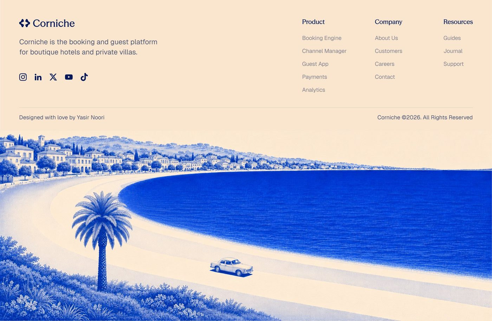 | **Corniche** — Corniche scenic bay Yasir Noori (@yasirahmadnoori) | [2119480416877084817](https://x.com/yasirahmadnoori/status/2119480416877084817) | Seed: apricot cream ground, cobalt line-art Mediterranean bay, palm + vintage car, Product/Company/Resources; credit Designed with love by Yasir Noori. |
| 02 | 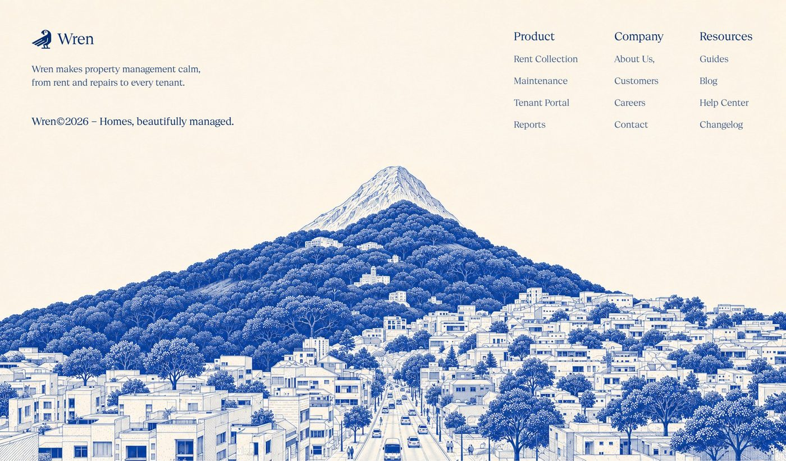 | **Wren** — Wren hillside town etching Yasir Noori (@yasirahmadnoori) | [2118960835930546279](https://x.com/yasirahmadnoori/status/2118960835930546279) | Same family as Corniche: cream + cobalt fine-line town climbing a wooded mountain. |
| 03 | 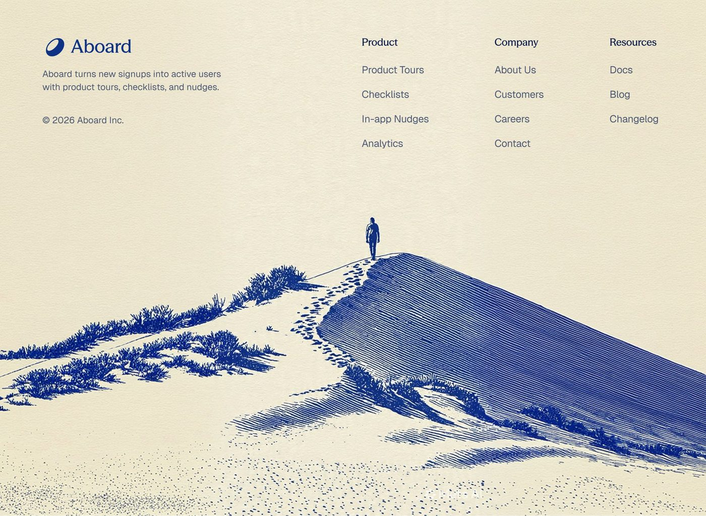 | **Aboard** — Aboard dune engraving Yasir Noori (@yasirahmadnoori) | [2117089008329294160](https://x.com/yasirahmadnoori/status/2117089008329294160) | Cream parchment + cobalt hairline dune with lone figure and footprints. |
| 04 | 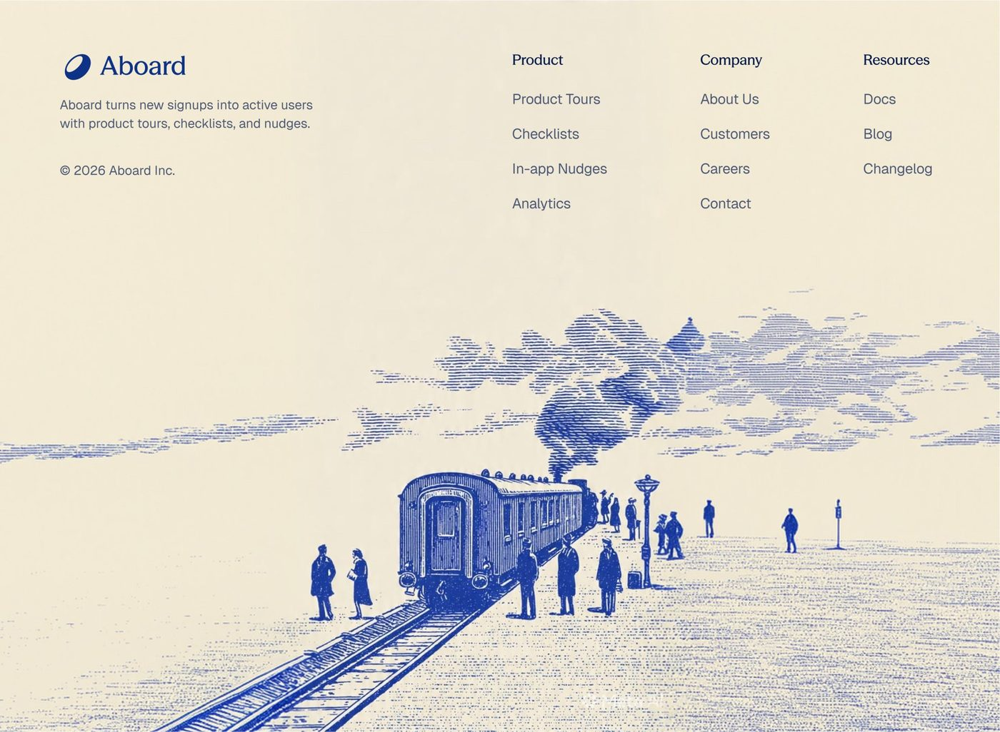 | **Aboard** — Aboard station lithograph Yasir Noori (@yasirahmadnoori) | [2117089008329294160](https://x.com/yasirahmadnoori/status/2117089008329294160) | Period train platform engraving under the same cream/cobalt link lattice. |
| 05 | 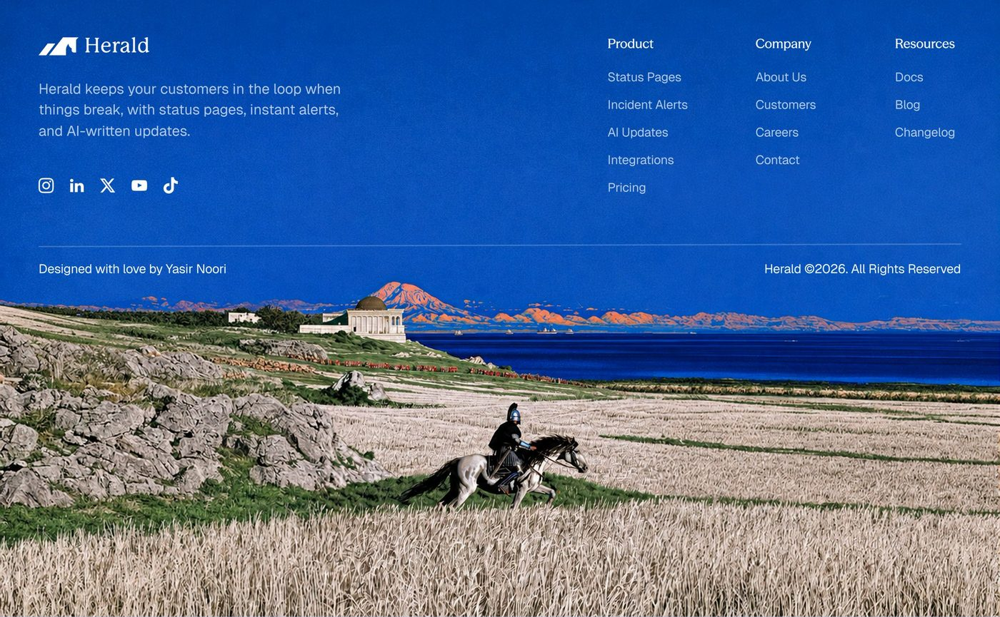 | **Herald** — Herald knight panorama Yasir Noori (@yasirahmadnoori) | [2116010553089171589](https://x.com/yasirahmadnoori/status/2116010553089171589) | Cobalt upper band + painterly wheat/sea/mountains with rider; credit line present. |
| 06 | 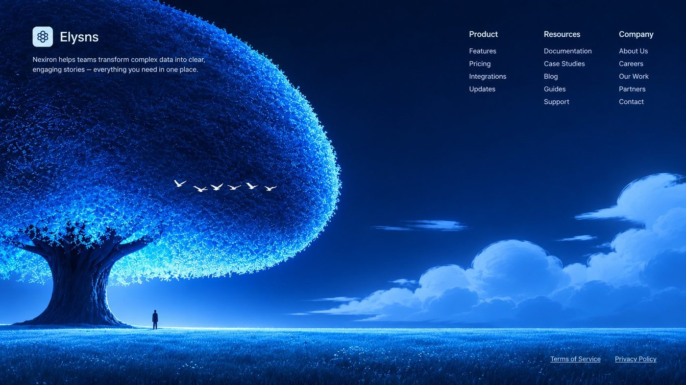 | **Elysns** — Elysns glowing tree night Pranav (@PranavOriginals) | [2118730202918658186](https://x.com/PranavOriginals/status/2118730202918658186) | Nocturnal cyan bioluminescent tree field; links float in the sky. |
| 07 | 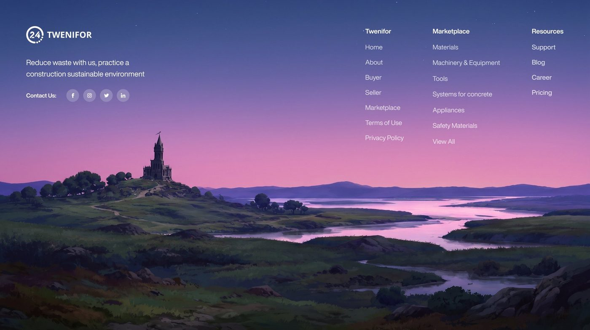 | **Twenifor** — Twenifor dusk castle landscape Hassan (@uixhassan) | [2116863277116404053](https://x.com/uixhassan/status/2116863277116404053) | Painterly indigo-to-pink dusk hills with castle and lake under white link columns. |
| 08 | 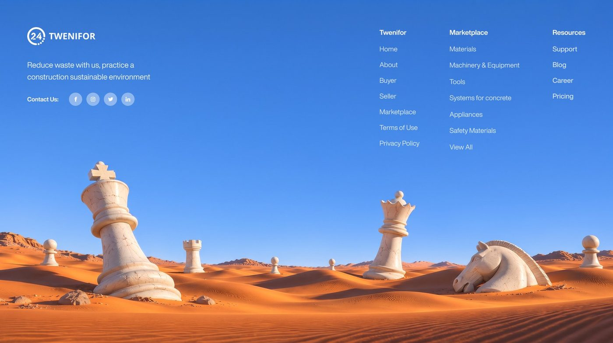 | **Twenifor** — Twenifor desert chess ruins Hassan (@uixhassan) | [2118329063412830459](https://x.com/uixhassan/status/2118329063412830459) | Surreal orange dunes + buried marble chess pieces under cobalt sky. |
| 09 | 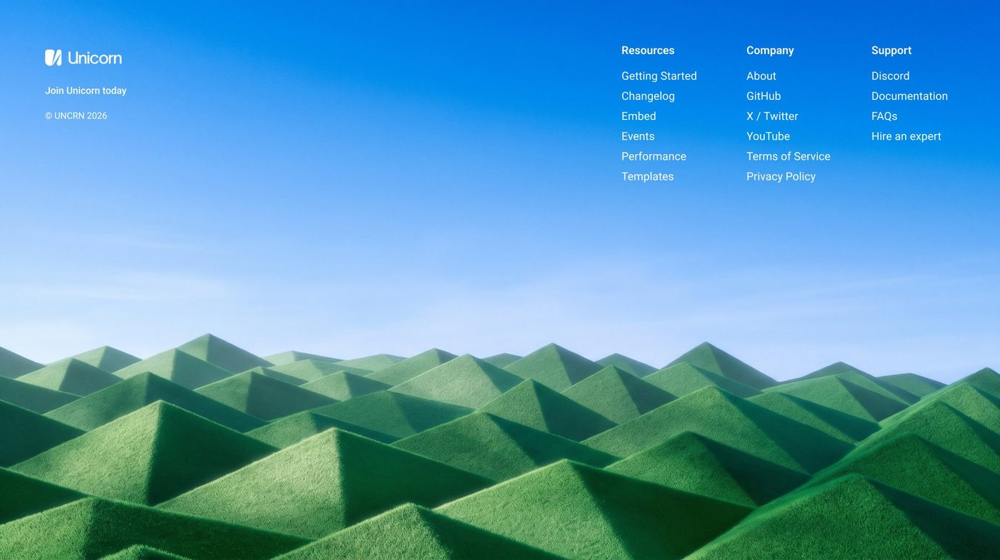 | **Unicorn** — Unicorn moss pyramids Hassan (@uixhassan) | [2117351915457806399](https://x.com/uixhassan/status/2117351915457806399) | Abstract green pyramidal moss field under pale sky; sparse white nav. |
| 10 | 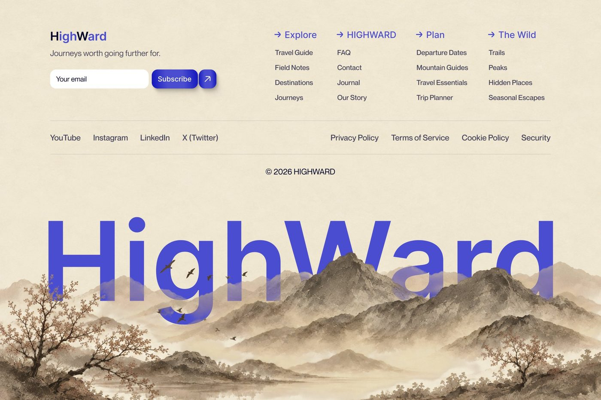 | **HighWard** — HighWard mist mountains Ameer Talha (@Talhadesignn) | [2091570101560705420](https://x.com/Talhadesignn/status/2091570101560705420) | Cream travel footer with ink-wash mountains and oversized translucent wordmark. |
| 11 | 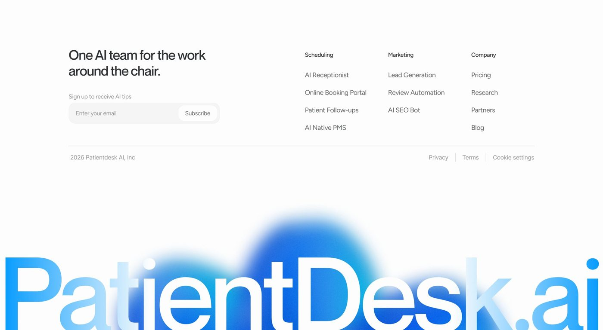 | **Patientdesk AI** — Patientdesk oversized glow wordmark Sahil Jada (@BySahilJada) | [2117176753131225562](https://x.com/BySahilJada/status/2117176753131225562) | Minimal white link lattice over massive cropped brand wordmark with blue aura. |
| 12 | 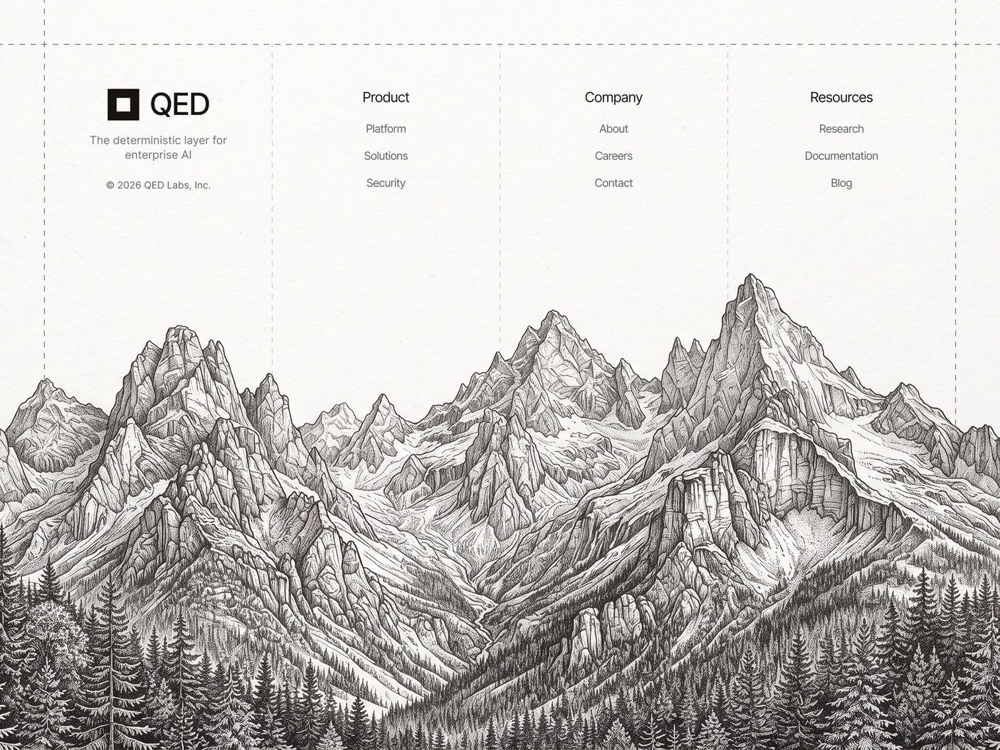 | **QED Labs** — QED pen-and-ink mountains Alim Joldaspayev (@alimdesigner_) | [2074463452773405073](https://x.com/alimdesigner_/status/2074463452773405073) | Off-white paper grid + full-width monochrome mountain engraving. |
| 13 | 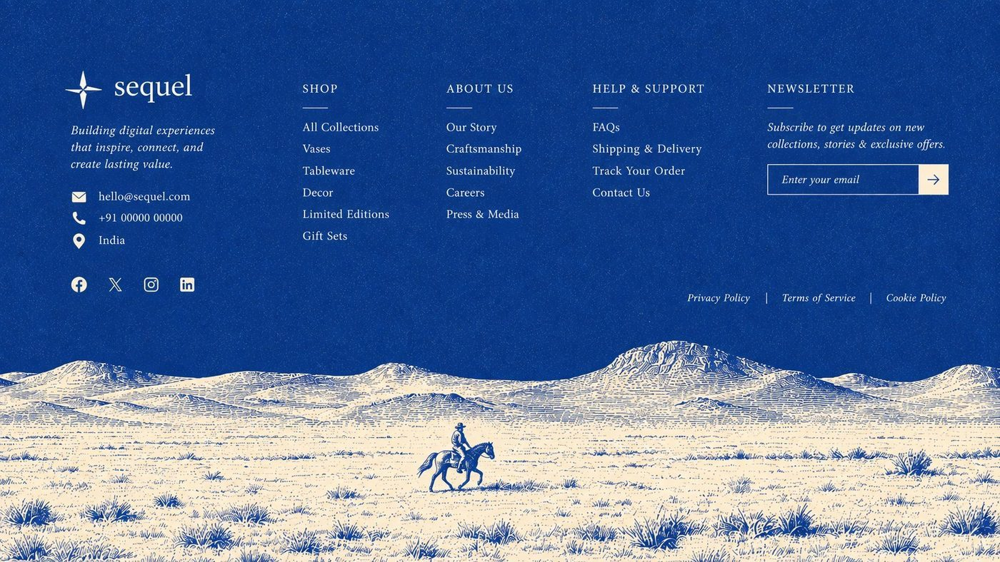 | **sequel** — sequel desert rider etching Pranav (@PranavOriginals) via @bestdesignsonx | [2109554673539748175](https://x.com/bestdesignsonx/status/2109554673539748175) | Cobalt textured upper band + ivory desert rider panorama. |
| 14 | 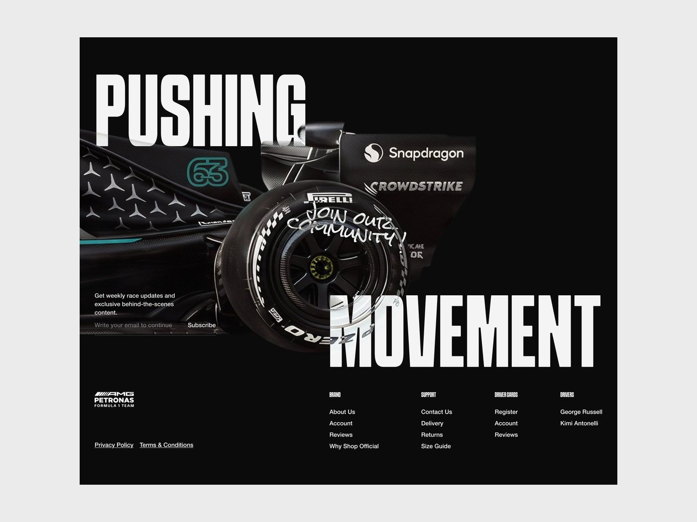 | **Mercedes-AMG PETRONAS F1** — AMG Petronas editorial dark footer Himawan (@adamhmwn) | [2086330674605408380](https://x.com/adamhmwn/status/2086330674605408380) | Dark editorial: F1 wheel hero + dense black link columns; contrast to scenic cream family. |

## 未入选（本轮看过）

- Yasir Herald-as-hero（[`01` 候选帖](https://x.com/yasirahmadnoori/status/2116929223701233865)）：更像 hero，不是 footer 收口。
- Pranav Elysns 灰度版：与入选 06 同构图，只留彩色夜景。
- Patientdesk 以外的常规白底 SaaS 三列（如 Loop、Tender 整页 CTA）：干净但不是本画廊要的“一眼风景/插画”。
- Rohit isometric FAQ：好看，但是 FAQ 区不是 footer。
- Aakib waveform 装饰底：趣味纹理，氛围弱于入选插画族。
- footer.design / inspora 若干条目：页面 429 或未拿到可公开下载的高清静帧，本轮不凭首页文案瞎收。

## 文件

- `entries/*.jpg` — 最长边 1400px 的参考压缩图
- `contact-sheet.jpg` — parent QA 拼图
- `catalog.json` — 机器可读索引（与上表同源）
